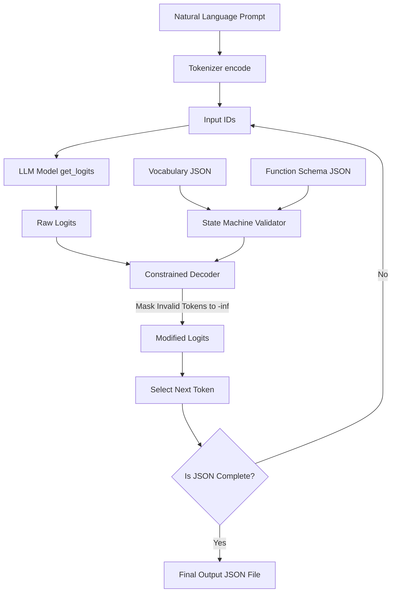

# [[Call Me Maybe]]: Function Calling in LLMs

This documentation serves as a comprehensive study and implementation guide for building an AI function-calling tool. The project focuses on bridging the gap between natural language processing and structured, machine-executable outputs using a small Large Language Model (LLM) and constrained decoding. 

---

## 00 - [[Project Overview]]

### What the Project Does
The project translates natural language requests into precise, structured function calls with typed arguments. For example, given the prompt "What is the sum of 40 and 2?", the system will not answer "42", but will output a JSON object specifying the function `fn_add_numbers` and the arguments `{"a": 40, "b": 2}`.

### Why the Project is Useful
LLMs excel at generating human language but struggle to produce reliable, machine-executable structures natively. Function calling enables LLMs to interact with external systems, execute code, chain complex operations, and extract structured data from unstructured text.

### High-Level Architecture
The system takes a natural language prompt, tokenizes it, and feeds it to an LLM (`Qwen/Qwen3-0.6B`). Instead of letting the model freely generate text, the system applies **constrained decoding**. This process modifies the probability of next-token generation (logits) at every step, allowing only tokens that form valid JSON and comply with a predefined schema. 

### What You Will Learn
*   How to build an AI generation pipeline from scratch.
*   How tokenization and logits work at a fundamental level.
*   How to implement constrained decoding to guarantee 100% valid JSON.
*   How to handle strict typing and schemas without relying on external libraries like `dspy` or `transformers`.

---

## 01 - [[Project Requirements]]

### Functional Requirements
*   **Input Processing**: The system must read input prompts from `data/input/function_calling_tests.json` and function definitions from `data/input/functions_definition.json`.
*   **Function Selection**: The system must choose the correct function to call based on the LLM's evaluation of the prompt.
*   **Output Generation**: The system must produce a single valid JSON file at `data/output/function_calling_results.json`.
*   **Structured Output**: Each JSON object in the output array must contain exactly three keys: `prompt`, `name`, and `parameters`.
*   **Strict Adherence**: No extra keys, text, or prose are allowed in the output. All required arguments must be present and correctly typed.

### Technical Requirements
*   **Language**: Python 3.10 or later.
*   **Coding Standard**: Must adhere to the `flake8` coding standard.
*   **Typing**: Code must include type hints and pass `mypy` static type checking without errors.
*   **Documentation**: Functions and classes must include docstrings following PEP 257 (Google or NumPy style).
*   **Automation**: A `Makefile` must be included with rules: `install`, `run`, `debug`, `clean`, `lint`, and optionally `lint-strict`.
*   **Execution Command**: `uv run python -m src [--functions_definition <file>] [--input <file>] [--output <file>]`.

### AI/LLM Concepts to Understand
*   Tokenization (subword units, BPE/SentencePiece) and Input IDs.
*   Logits (probability distributions over possible next tokens).
*   Constrained Decoding (modifying logits to enforce schema).

### Software and Libraries Required
*   **Allowed**: `pydantic` (mandatory for all class validation), `numpy`, `json`, `uv` (for package management).
*   **Forbidden**: `dspy`, `pytorch`, `huggingface`, `transformers`, `outlines`, or any heuristics/magic for function selection. Private methods/attributes from `llm_sdk` are strictly forbidden.

### Expected Project Behavior & Performance
*   **Accuracy**: 90%+ correct function selection and argument extraction.
*   **Reliability**: 100% valid JSON that is always parseable and schema-compliant.
*   **Speed**: Process all test prompts in under 5 minutes on standard hardware.
*   **Error Handling**: Graceful handling of malformed inputs, missing files, and edge cases; the program must never crash unexpectedly. Resources must be managed via context managers.

### Constraints & Assumptions
*   **Constraint**: The function must be chosen using the LLM, not via hardcoded heuristics.
*   **Constraint**: Must not rely on prompting the model and hoping for correct JSON; constrained decoding is mandatory.
*   **Assumption**: Since `pytorch` is forbidden, the `Tensor` returned by `encode` in the provided `llm_sdk` is likely a mock or a simplified array representation native to the SDK.
*   **Assumption**: The vocabulary file provided by `get_path_to_vocab_file()` is a JSON or text file mapping integer token IDs to their exact string representations, which you must parse manually to map valid characters.

---

## 02 - [[Prerequisites]]

Before starting implementation, ensure you have the following knowledge base:

### Programming Knowledge Required
*   **Advanced Python**: Context managers (`with` statements) for resource handling, exception handling (`try-except`), and virtual environments.
*   **Static Typing**: Proficiency with Python's `typing` module and using `mypy` for static analysis.
*   **Data Validation**: Experience using `pydantic` for defining strict data schemas and validating complex nested dictionaries[cite: 1].

### AI/ML Knowledge Required
*   **Tokenization**: Understanding how text is split into tokens (e.g., preserving leading spaces like `Ġ`)[cite: 1].
*   **Probability & Logits**: Understanding that neural networks output raw scores (logits) that correspond to probabilities of the next item[cite: 1].

---

## 03 - [[LLM Fundamentals]]

To build this project, you must understand the underlying mechanics of how a Large Language Model generates text.

### Artificial Intelligence & Large Language Models
An LLM is a neural network trained on vast amounts of text. At its core, it is a sophisticated pattern-matching engine that predicts the next most likely piece of text based on the context it has received.

### Tokens and Tokenization
Models do not read text letter-by-letter or word-by-word. They read **tokens**.
*   **Tokenization**: The process of breaking text into subword units[cite: 1]. 
*   **Subword intricacies**: Tokenizers often include leading spaces and handle punctuation specifically[cite: 1]. For example, the text "What is the sum" might be tokenized as `["What", "Ġis", "Ġthe", "Ġsum"]`, where `Ġ` represents a preceding space[cite: 1].
*   **Input IDs**: Each token string is mapped to a unique numerical ID from the model's vocabulary[cite: 1].

### Logits and Token Selection
When an LLM processes Input IDs, it outputs **logits**[cite: 1]. 
*   Logits are raw, unnormalized probability scores for every possible next token in the vocabulary[cite: 1].
*   In standard text generation, the token with the highest logit (or sampled from the top distribution) is selected and appended to the prompt[cite: 1].
*   This process repeats token-by-token until a completion token is reached[cite: 1].

---

## 04 - [[Function Calling]]

### What is Function Calling?
Function calling bridges the gap between natural language understanding and structured, machine-executable output[cite: 1]. It translates natural language requests into precise function calls with typed arguments[cite: 1].

### Normal Generation vs. Constrained Decoding
Normally, if you prompt an LLM to "output JSON", a small 0.6B parameter model might only succeed 30% of the time[cite: 1]. It might output invalid trailing commas, extra conversational text, or hallucinate keys.

**Constrained Decoding** guarantees 100% valid structure by modifying the generation process natively[cite: 1]:
1.  The model produces logits for all possible tokens[cite: 1].
2.  The application code (your project) determines which tokens maintain valid JSON structure and comply with the expected schema[cite: 1].
3.  The application sets the logits for all *invalid* tokens to negative infinity (`-inf`)[cite: 1].
4.  The application samples the next token only from the remaining valid options[cite: 1].

### JSON Schemas
In this project, functions are defined using a JSON schema[cite: 1]. 
*   A schema dictates exactly what keys are allowed (e.g., `parameters`) and what data types they hold (e.g., `number`, `string`)[cite: 1].
*   Your constrained decoder will read this schema and use it as a state machine. If the schema expects a `number`, your decoder must mask out (set to `-inf`) any tokens that represent alphabet letters, allowing only digit tokens, decimals, or structural JSON tokens[cite: 1].

---

## 05 - [[Project Architecture]]

The project relies on a pipeline of components working in a loop.

### Components & Responsibilities
1.  **Input Processor**: Parses `function_calling_tests.json` and `functions_definition.json` using `pydantic`[cite: 1].
2.  **LLM Interface (`llm_sdk`)**: Uses `encode()` to convert prompts to Input IDs and `get_logits_from_input_ids()` to get network predictions[cite: 1].
3.  **Vocabulary Mapper**: Parses the file from `get_path_to_vocab_file()` to map token IDs back to strings[cite: 1].
4.  **State Machine / JSON Validator**: Tracks the current state of the generated JSON (e.g., "expecting key", "expecting string value", "expecting number").
5.  **Constrained Decoder**: Masks the logits provided by the LLM Interface based on the State Machine's rules.

### Data Flow Diagram


## 06 - [[Implementation Guide]]

Follow these steps to build the project progressively. Do not skip steps.

### Step 1: Project Setup and Boilerplate

**What**: Set up the repository, `Makefile`, and dependencies using `uv`[cite: 1]. **Why**: Ensures a standardized, isolated environment required by the project instructions[cite: 1].

Makefile

```
# Makefile
install:
	uv venv
	uv pip install pydantic numpy
run:
	uv run python -m src
debug:
	uv run python -m pdb -m src
clean:
	rm -rf __pycache__ .mypy_cache
lint:
	flake8 src
	mypy --warn-return-any --warn-unused-ignores --ignore-missing-imports --disallow-untyped-defs --check-untyped-defs src
```

### Step 2: Input Parsing with Pydantic

**What**: Create strict `pydantic` models for the input files. **Why**: Validates incoming data and satisfies the requirement that all classes use `pydantic` for validation[cite: 1].

Python

```
# src/models.py
from pydantic import BaseModel, Field
from typing import Dict, Any, List

class ParameterDef(BaseModel):
    type: str

class FunctionDef(BaseModel):
    name: str
    description: str
    parameters: Dict[str, ParameterDef]
    returns: Dict[str, str]

class PromptInput(BaseModel):
    prompt: str
```

_Test this step_: Write a short script to load `data/input/functions_definition.json` and instantiate a `List[FunctionDef]`.

### Step 3: Vocabulary Mapping

**What**: Load the vocabulary file provided by `get_path_to_vocab_file()`[cite: 1]. **Why**: You need to know exactly what string corresponds to token ID `X` to decide if token ID `X` is valid JSON/schema[cite: 1].

Python

```
# src/vocab.py
import json
from typing import Dict
# Assumption: llm_sdk is available in the root path.
from llm_sdk import Small_LLM_Model 

def load_vocabulary(model: Small_LLM_Model) -> Dict[int, str]:
    vocab_path = model.get_path_to_vocab_file()
    with open(vocab_path, 'r', encoding='utf-8') as f:
        # Assuming the vocab file maps strings to IDs or IDs to strings.
        # You will need to inspect the file to parse it correctly.
        return json.load(f)
```

### Step 4: The State Machine for JSON Validation

**What**: Build a class that takes a partial JSON string and a target schema, and returns what characters/strings are currently valid. **Why**: If the current string is `{"name": "fn_add_numbers", "parameters": {"a": 4`, the state machine knows the next characters must be digits, a decimal, or a closing brace.

### Step 5: Constrained Decoding Loop

**What**: The core logic. Loop through token generation, masking logits. **Why**: This enforces the 100% valid JSON requirement without relying on the LLM's natural prompting abilities[cite: 1].

Python

```
# src/decoder.py
import numpy as np
from typing import List
from llm_sdk import Small_LLM_Model

def constrained_decode(prompt: str, model: Small_LLM_Model, state_machine, vocab: Dict[int, str]) -> str:
    input_ids = model.encode(prompt).tolist() # Assuming Tensor has tolist()
    generated_text = ""
    
    while not state_machine.is_complete(generated_text):
        logits = model.get_logits_from_input_ids(input_ids)
        # Convert to mutable numpy array
        logits_array = np.array(logits) 
        
        # Masking step
        for token_id, token_str in vocab.items():
            if not state_machine.is_token_valid(generated_text, token_str):
                logits_array[token_id] = -np.inf
                
        # Token Selection (Greedy - pick highest probability)
        next_token_id = int(np.argmax(logits_array))
        next_token_str = vocab[next_token_id]
        
        # Append and loop
        generated_text += next_token_str
        input_ids.append(next_token_id)
        
    return generated_text
```

_Common Mistake_: Forgetting to handle special characters like `Ġ` (spaces) when evaluating if a token string is valid JSON[cite: 1].

### Step 6: Output Formatting and File Management

**What**: Write the final parsed JSON to `data/output/function_calling_results.json`[cite: 1]. **Why**: Meets the final I/O requirements of the project. Make sure to use a context manager to write the file[cite: 1].

## 07 - [[Testing and Debugging]]

### Execution

Run your project using the exact specified command[cite: 1]:

Bash

```
uv run python -m src --functions_definition data/input/functions_definition.json --input data/input/function_calling_tests.json --output data/output/function_calling_results.json
```

### Edge Cases to Test

- Empty string prompts[cite: 1].
    
- Large numbers or special characters in the prompt[cite: 1].
    
- Ambiguous prompts where multiple functions might seem relevant[cite: 1].
    
- Functions requiring multiple parameters of different types[cite: 1].
    

### Debugging Strategies

1. **Logit Inspection**: If your model outputs garbage, print the top 5 valid tokens and their logits _before_ masking, and _after_ masking.
    
2. **Vocabulary Alignment**: Ensure you are stripping/handling subword markers (like `Ġ`) properly before feeding strings to your JSON validator[cite: 1].
    

## 08 - [[Security & Best Practices]]

> **Important**: This project emphasizes robust execution. The program must never crash unexpectedly[cite: 1].

- **Error Handling**: Wrap the main execution loop in a `try-except` block. If a specific prompt fails, log the error, output a safe fallback (or skip), and continue to the next prompt[cite: 1].
    
- **Resource Management**: Always use `with open(...) as f:` to ensure automatic cleanup of file handles[cite: 1].
    
- **Input Validation**: Ensure input files exist before attempting to read them. The project requires you to gracefully handle missing files or invalid JSON in the inputs[cite: 1].
    

## 09 - [[Common Mistakes]]

- - [ ] **Relying on Prompting**: Hoping the model will naturally output JSON. This is an immediate failure criteria; you _must_ use constrained decoding[cite: 1].
        
- - [ ] **Hardcoding Function Logic**: Choosing the function using regex, `if "sum" in prompt:`, or heuristics. The LLM's logits must dictate the function choice[cite: 1].
        
- - [ ] **Ignoring the Space Character**: Failing to account for `Ġ` or other tokenizer-specific space characters when evaluating string validity[cite: 1].
        
- - [ ] **Invalid Output Keys**: Returning a JSON object with keys other than exactly `prompt`, `name`, and `parameters`[cite: 1].
        
- - [ ] **Crashing on Bad Input**: Failing to use proper `try-except` blocks, causing the entire script to die on one bad prompt[cite: 1].
        

## 10 - [[Learning Roadmap & Exercises]]

### Stage 1: Setup and Pydantic

- **Exercise 1**: Write a `Makefile` that sets up `uv` and runs a simple "Hello World" Python script.
    
- **Exercise 2**: Create a `pydantic` model for a generic user profile and write a script that fails gracefully when fed invalid JSON data.
    

### Stage 2: Tokenization Exploration

- **Exercise 3**: Write a mock tokenizer function that replaces spaces with `Ġ`. Understand how string concatenation works with these tokens.
    

### Stage 3: State Machine Logic

- **Exercise 4**: Write a Python function `is_valid_next_char(current_json: str, next_char: str) -> bool`. Test it manually by feeding it `{"name": "` and checking if `}` returns `False` and `"test"` returns `True`.
    

### Stage 4: Constrained Decoding (Core)

- **Exercise 5**: Combine the mock tokenizer, a dummy array of logits, and the state machine to forcefully generate the string `{"status": "ok"}` regardless of the dummy logits.
    

## 11 - [[Glossary]]

- **Constrained Decoding**: Intervening in the generation process by modifying logits before token selection to guarantee valid structure[cite: 1].
    
- **Logits**: The raw, unnormalized probability scores produced by a neural network for every possible next token[cite: 1].
    
- **Tokenization**: The process of breaking text into subword units. Often handles punctuation and leading spaces uniquely[cite: 1].
    
- **Pydantic**: A Python library for data parsing and validation using Python type annotations[cite: 1].
    
- **LLM SDK**: The provided `Small_LLM_Model` wrapper class used to interact with the LLM without directly relying on external ML libraries like `transformers`[cite: 1].
    

## 12 - [[Final Checklist]]

Use this checklist before submitting your repository:

- [ ] Repository contains `src/`, `pyproject.toml`, `uv.lock`, `llm_sdk/`, `data/input/`, and `README.md`[cite: 1].
    
- [ ] Output directory is **not** included in the repository[cite: 1].
    
- [ ] `Makefile` contains `install`, `run`, `debug`, `clean`, and `lint` rules[cite: 1].
    
- [ ] Code passes `flake8` and `mypy` without errors[cite: 1].
    
- [ ] All classes use `pydantic` for validation[cite: 1].
    
- [ ] No forbidden libraries (`dspy`, `pytorch`, `transformers`, etc.) are used[cite: 1].
    
- [ ] `README.md` begins with the exact italicized sentence required: _This project has been created as part of the 42 curriculum by..._[cite: 1].
    
- [ ] `README.md` includes algorithm explanation, design decisions, performance analysis, challenges, testing strategy, and example usage[cite: 1].
    
- [ ] Constrained decoding is implemented properly (modifying logits, not prompting)[cite: 1].
    
- [ ] Output JSON perfectly matches the `prompt`, `name`, `parameters` schema[cite: 1].
    
